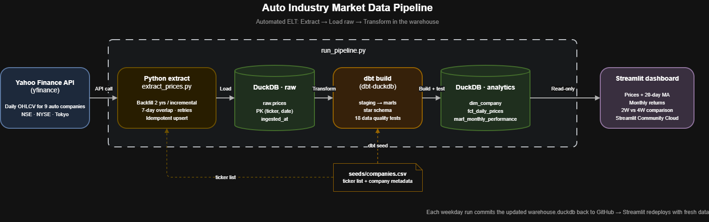
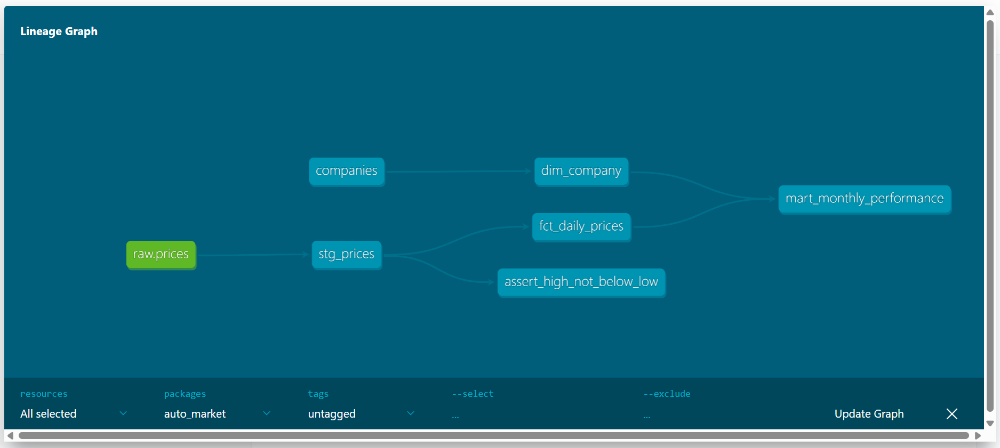

# 🚗 Auto Industry Market Data Pipeline

An automated ELT pipeline that pulls daily stock prices for 9 automotive companies (India, Japan, US listings), loads them into a DuckDB warehouse, models them with dbt into a tested star schema, runs itself every weekday on GitHub Actions, and serves a live Streamlit dashboard.

**Live dashboard:** `<paste your Streamlit link here>`



## Architecture

```
yfinance API ──► Python extract ──► DuckDB  raw.prices
                                        │
                                   dbt build
                     staging.stg_prices  →  analytics.dim_company
                                         →  analytics.fct_daily_prices
                                         →  analytics.mart_monthly_performance
                                        │
                                Streamlit dashboard

GitHub Actions runs extract + dbt every weekday at 22:00 UTC
```

## Tech stack

| Tool | Role | Why | Production equivalent |
|---|---|---|---|
| Python + yfinance | Extract & load | Free daily market data, no API key | Fivetran / Airbyte, any REST API |
| DuckDB | Warehouse | Real analytical SQL in a single file | Snowflake, BigQuery |
| dbt (dbt-duckdb) | Transform & test | Layered models, tests, lineage | Same tool |
| GitHub Actions | Scheduling | Free cloud cron | Airflow, Dagster |
| Streamlit + Plotly | Dashboard | Python-only, free hosting | Tableau, Looker |

## Companies tracked

Maruti Suzuki, Mahindra & Mahindra, TVS Motor, Bajaj Auto, Hero MotoCorp, Eicher Motors (NSE); Toyota, Honda (NYSE ADRs); Suzuki Motor Corp (Tokyo). The list lives in `dbt_project/seeds/companies.csv`, which is the single source of truth for both the extract script and the dimension table.

## Data model (star schema)



| Model | Layer | Grain | Notes |
|---|---|---|---|
| `stg_prices` | staging (view) | ticker × trading day | renamed, typed, null closes dropped, deduplicated |
| `dim_company` | mart | ticker | name, country, segment, currency |
| `fct_daily_prices` | mart (fact) | ticker × trading day | daily return (`LAG`), 20-day moving average, 52-week high |
| `mart_monthly_performance` | mart | ticker × month | monthly return, average volume, volatility |

## Data quality (18 dbt tests)

| Test | Catches |
|---|---|
| `unique` + `not_null` on `price_id`, `month_id`, `dim_company.ticker` | duplicate or missing rows |
| `not_null` on ticker, date, close | broken extracts |
| `positive_value` (custom generic test) on close | corrupt prices |
| `accepted_values` on segment | typos in the seed |
| `relationships` fact → dim_company | tickers loaded without company metadata |
| `assert_high_not_below_low` (singular test) | impossible OHLC rows |

`dbt build` runs tests right after each model, so a failing staging test **skips every downstream model** and bad data never reaches the dashboard.

## Run it locally

```bash
python -m venv .venv && source .venv/bin/activate   # Windows: .venv\Scripts\activate
pip install -r requirements.txt
python run_pipeline.py                # extract + dbt build
streamlit run dashboard/app.py        # open http://localhost:8501
```

Unit tests for the extract step (no network needed): `pytest -q`

## Design decisions

- **ELT, not ETL.** Raw data lands untouched; all transformation happens in SQL inside the warehouse, so models can be rebuilt from raw at any time.
- **Idempotent loads.** `PRIMARY KEY (ticker, date)` + `INSERT OR REPLACE`. Running the pipeline twice gives the same row count.
- **Incremental with a 7-day overlap.** New tickers are backfilled 2 years; existing tickers re-pull from (last loaded date − 7 days). The overlap absorbs late corrections, and anchoring on the last loaded date fills gaps after missed runs.
- **Fault isolation.** Each ticker retries 3× with backoff; one failure doesn't stop the others. If all fail, the job exits non-zero and GitHub marks the run failed.
- **Source isolated in one file.** Switching to Alpha Vantage or Stooq only changes `extract_prices.py`.
- **Prices are in local currency** (INR/USD/JPY), so cross-company comparisons use returns and indexed performance, not raw prices.

### Known trade-off
For v1 the DuckDB file is committed back to the repo by the scheduled job. That's fine at this size, but in production state would live in object storage (S3) or a cloud warehouse, with secrets in a secrets manager.

## Next steps

- Orchestrate with Airflow/Dagster, with alerting on failure
- Move storage to S3 + Snowflake/BigQuery
- Incremental dbt models (`materialized='incremental'`)
- Source freshness checks and Slack alerts
- An LLM "ask your data" text-to-SQL feature over the marts

---
Data from Yahoo Finance via yfinance, for educational use only.
